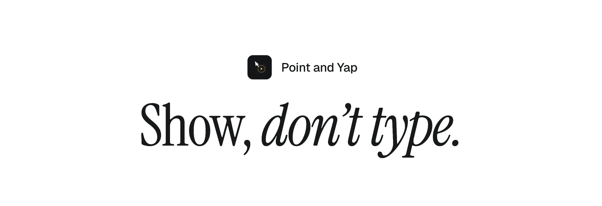
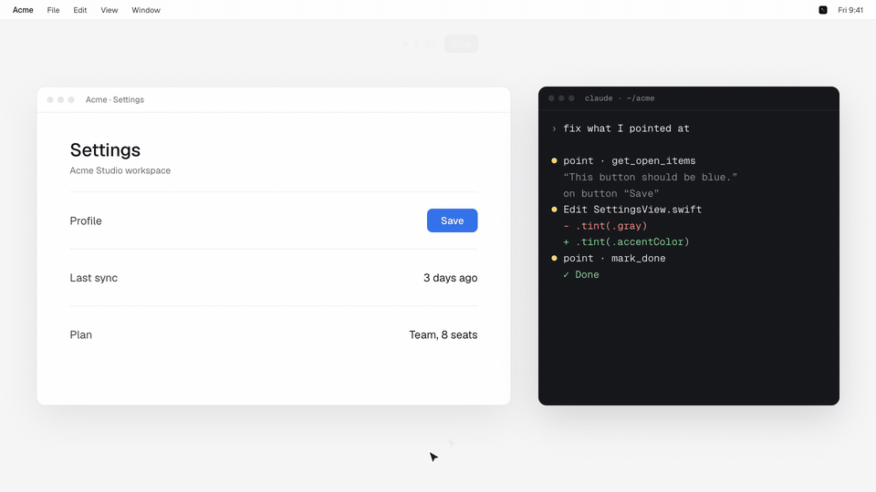
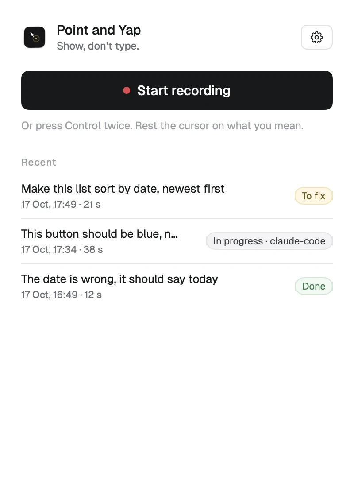
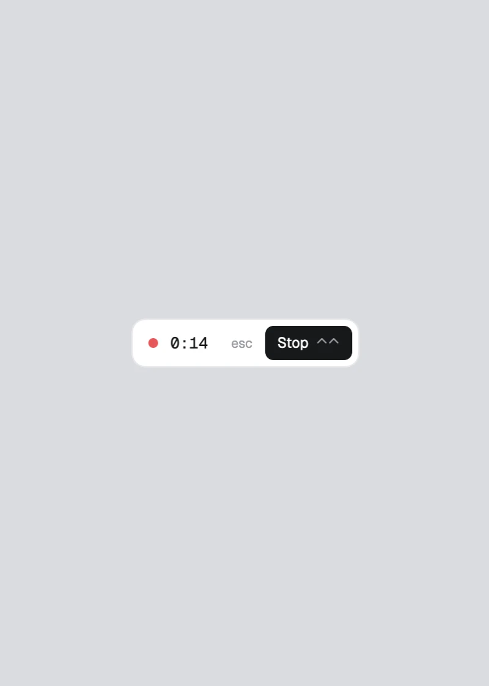
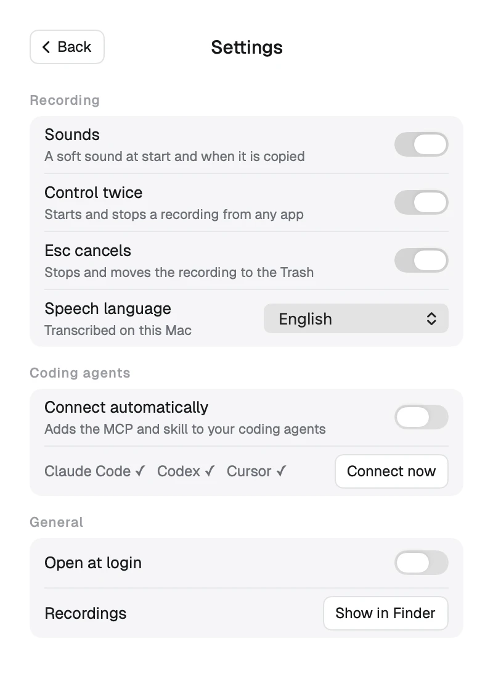
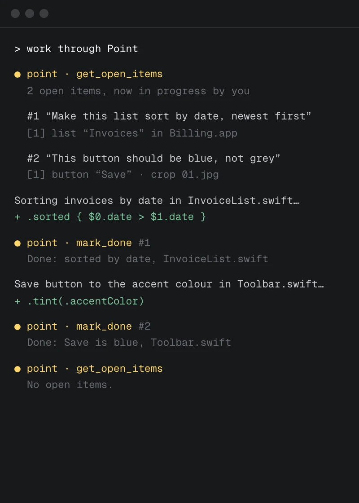

<p align="center">
  
</p>

<p align="center" style="margin-bottom: 8px;">
  <a href="https://pointandyap.com" title="Visit pointandyap.com"></a>
  &nbsp;
  <a href="LICENSE"></a>
  &nbsp;
  <a href="#install"></a>
  &nbsp;
  <a href="#mcp-tools"></a>
  &nbsp;
  <a href="CHANGELOG.md"></a>
  &nbsp;
  <a href="https://github.com/mfmaur/pointandyap/actions/workflows/ci.yml"></a>
</p>

<p align="center">
  
</p>

**Point and Yap** is a small Mac app for showing your coding agent what to change. Press Control twice, talk while you
point at things on screen, press Control twice again. Each recording becomes an item in a local queue, with what you said,
the element under the cursor and a cropped screenshot. Claude Code, Codex or Cursor pick it up over MCP, fix it and mark it
done.

<p align="center"><sub><a href="#install">Install</a> · <a href="#how-it-works">How it works</a> · <a href="#mcp-tools">MCP tools</a> · <a href="#faq">FAQ</a> · <a href="#license">License</a></sub></p>

<table>
  <tr>
    <td width="50%"></td>
    <td width="50%"></td>
  </tr>
  <tr>
    <td width="50%"></td>
    <td width="50%"></td>
  </tr>
</table>

## Install

Requires macOS 26 or later and a Mac with Apple silicon.

```bash
curl -fsSL https://pointandyap.com/install.sh | sh
```

or with Homebrew (trust the tap once, then install):

```bash
brew trust mfmaur/tap
brew install --cask mfmaur/tap/point-and-yap
```

or by hand: download `PointAndYap.dmg` from [pointandyap.com](https://pointandyap.com) or the
[latest release](https://github.com/mfmaur/pointandyap/releases/latest) and drag Point and Yap into Applications. Every
build is signed and notarized by Apple; the install script checks the DMG with `spctl` before it copies anything.

Then open it, allow the three permissions it asks for, and answer one question: it lists the coding agents it found and
asks before connecting them. Connect, or Skip and do it later in Settings.

### Permissions, and why

- **Microphone**: records what you say while you point.
- **Screen Recording**: takes the screenshots at each point and click. The recording pill is never in them.
- **Accessibility**: reads the element under the cursor (role, label, window, app), so an agent can find it in code.

## How it works

1. Press Control twice (or Start recording). A small pill with the time and Stop stays on top.
2. Talk and point: rest the cursor on the thing you mean while you say "this", "here", "that one". Clicks count too.
3. Press Control twice again. A soft sound plays and two lines go on the clipboard for any agent: what is new and how to get it.
4. The agent calls `get_open_items`, makes the change and calls `mark_done`. The window shows To fix, In progress (by
   which agent) or Done for each recording.

Esc while recording cancels it and moves it to the Trash.

### Everything stays on your Mac

Speech is transcribed by Apple's on-device model. Recordings, screenshots, the queue and the MCP server all live on your
Mac, in `~/Point/sessions`. No account, no server, no analytics. The only download is Apple's speech model, which macOS
fetches once.

## MCP tools

`/Applications/Point.app/Contents/MacOS/Point --mcp` is a local MCP server over stdio, named `point`. After you say
Connect, it is added to Claude Code (user scope), Codex (`~/.codex/config.toml`) and Cursor (`~/.cursor/mcp.json`), and a
skill is linked into `~/.claude/skills` and `~/.agents/skills`. Each config is backed up first to
`~/Library/Application Support/Point/backups/`. An existing entry named `point` that is not ours is left alone.

| Tool | What it does |
| --- | --- |
| `get_open_items` | The open items, oldest first, with what was said, the elements and the crops. Marks them in progress by the calling agent. |
| `start_items` | Marks specific open items in progress by you. |
| `list_items` | Every item with its state: open, in progress (by whom, since when) or done (with the note). |
| `mark_done` | Marks items done with a one-line note. Done items are never handed out again. |
| `release_items` | Gives items back to the queue, with a note why. |
| `list_sessions`, `get_session`, `get_frame` | The recordings themselves: the aligned timeline, crops and full screenshots. |

An item in progress that no one finishes goes back to the queue after two hours. One file lock keeps two agents from taking
the same item.

### Shell fallback

For an agent without MCP:

```bash
/Applications/Point.app/Contents/MacOS/Point --items
```

```bash
POINT_AGENT=my-agent /Applications/Point.app/Contents/MacOS/Point --done <id> --note "what changed"
```

## FAQ

**Does anything leave my Mac?** No. See [Everything stays on your Mac](#everything-stays-on-your-mac).

**Which agents work?** Claude Code, Codex and Cursor are connected for you. Any MCP client that runs a local stdio server
works with the command above, and any agent with a shell can use `--items` and `--done`.

**I skipped connecting. How do I connect later?** Settings, Coding agents, Connect now.

**How do I remove it?** Quit it and delete it from Applications. To remove the agent entries: `claude mcp remove point
--scope user`, the `[mcp_servers.point]` table in `~/.codex/config.toml`, `point` in `~/.cursor/mcp.json`, and the `point`
links in `~/.claude/skills` and `~/.agents/skills`. Recordings are in `~/Point`.

**Does it work on older Macs or Intel?** Not yet. Only speech-to-text needs macOS 26 (SpeechAnalyzer, Apple's on-device
model with word timings, which lines up each word with where the cursor was). Wider support is planned.

**Can I build it myself?** Yes: [docs/DEVELOPMENT.md](docs/DEVELOPMENT.md). `swift test` runs the tests over a synthetic
recording.

## Contributing

Issues and pull requests are welcome: [CONTRIBUTING.md](CONTRIBUTING.md). Report security issues privately as described in
[SECURITY.md](SECURITY.md). This project follows a [code of conduct](CODE_OF_CONDUCT.md).

## License

[MIT](LICENSE). Provided as is, without warranty of any kind.

I made Point and Yap because it helps me build. Maybe it helps you too.
